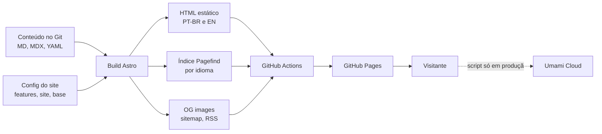
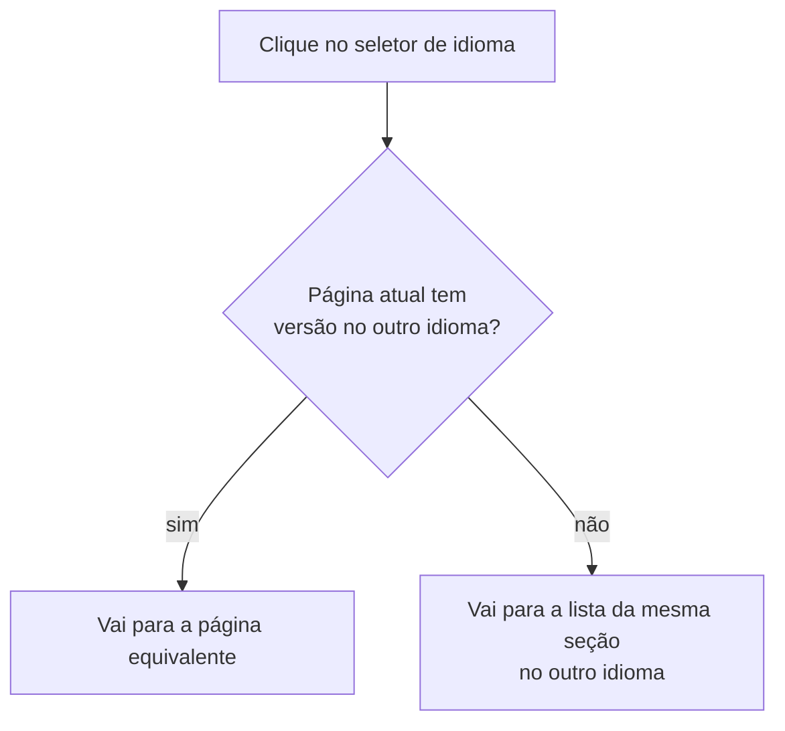
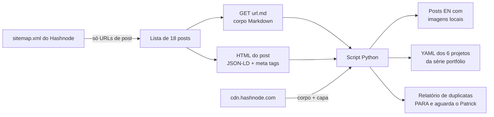

# TDD - Novo site cpatrickalves.com

| Campo | Valor |
| --- | --- |
| Tech Lead | Patrick Alves (`cpatrickalves`) |
| Time | Patrick Alves; agente Claude Code na execução |
| Épico / Tickets | GitHub Issues de `cpatrickalves/personal-site` (a criar a partir das fases) |
| Plano de execução | [`docs/PLAN.md`](PLAN.md) |
| Design de referência | [getrubric.app](https://www.getrubric.app/) (só linguagem visual) |
| Status | Draft |
| Criado | 2026-10-29 |
| Última atualização | 2026-10-29 |

> **Documento temporário.** Este TDD e o `docs/PLAN.md` existem só durante a implementação. Ao final, o que continuar valendo (arquitetura, decisões, como publicar e como escrever posts) vai para a documentação permanente gerada com a skill `/docs-generator`, e os dois arquivos são apagados.

**Divisão entre os dois documentos:** este TDD registra arquitetura, contratos e decisões. O `PLAN.md` é o roteiro de execução, com tarefas por fase, critérios de pronto, arquivos de origem das peças do karhdo.dev e os dados do autor. Quando os dois divergirem, vale o `PLAN.md` para o *como* e este TDD para o *porquê*. A divergência deve ser corrigida nos dois.

---

## Contexto

Hoje o cpatrickalves.com é um blog no Hashnode com domínio próprio, 18 posts em inglês, incluindo uma série de portfólio com 6 projetos de ciência de dados. O conteúdo só existe na plataforma. O repositório antigo `cpatrickalves/hashnode-blog` está parado desde 2023 e não serve como fonte.

O novo site é um site pessoal estático e bilíngue (PT-BR e EN). Ele apresenta quem é o Patrick e a Cognicode, e reúne blog, projetos e palestras. O site é construído com Astro sobre o tema AstroPaper, mais algumas peças copiadas do karhdo.dev, e publicado no GitHub Pages. Todo o conteúdo fica versionado em Markdown, MDX e YAML no próprio repositório.

**Domínio:** publicação de conteúdo pessoal e profissional: blog técnico, portfólio e vitrine de consultoria.

**Stakeholders:**

- **Patrick:** autor, mantenedor e quem aprova design e conteúdo.
- **Leitores PT-BR e EN:** público do blog técnico (IA, agentes, ciência de dados).
- **Potenciais clientes da Cognicode:** chegam pela home e pela página de projetos.

## Definição do Problema

### Problemas que estamos resolvendo

- **Pouco controle de design e marca.** O Hashnode limita o layout e a identidade visual.
  - Impacto: o site não comunica a estética de IA e agentes que o Patrick quer, nem aceita componentes interativos (diagramas animados, MDX).
- **Não existe site bilíngue.** O Hashnode não oferece i18n de verdade, e os posts existem só em inglês.
  - Impacto: o público brasileiro fica de fora, e não há como ligar a versão PT-BR à EN do mesmo post.
- **É um blog, não uma vitrine.** Não há lugar para apresentação pessoal, para a Cognicode, para projetos em cards ou para palestras.
  - Impacto: quem chega pelo domínio não vê o trabalho profissional nem a consultoria.
- **Dependência da plataforma.** O conteúdo está preso no Hashnode, que não tem versionamento e pode mudar recursos ou preços a qualquer momento.
  - Impacto: risco de perder conteúdo e imagens (`cdn.hashnode.com`), e nenhum controle sobre o futuro do blog.

### Por que agora?

- O Patrick quer usar o site como vitrine da Cognicode e da sua atuação com IA e agentes.
- O conteúdo antigo ainda está no ar, com imagens acessíveis. Quanto mais tempo passa, maior o risco de perder parte dele.

### Impacto de não resolver

- **Profissional:** a presença online continua sendo um blog genérico, sem portfólio nem consultoria.
- **Conteúdo:** os posts continuam dependentes de uma plataforma de terceiros, sem backup versionado.
- **Público:** os leitores em português continuam sem atendimento.

## Escopo

### ✅ No escopo (lançamento)

- Site estático em Astro sobre o AstroPaper, com peças do karhdo.dev: barra superior, busca ⌘K, tema claro/escuro e Expressive Code.
- Design system próprio: tokens claro/escuro, fontes Outfit e Doto, componentes base, primitivas de animação e a página `/styleguide` (só em dev).
- i18n com PT-BR na raiz e EN em `/en`: rotas, coleções, seletor de idioma, `hreflang`, sitemap, RSS e OG images por idioma.
- Páginas Home, Blog (lista e post), Projetos e Sobre. A página de Palestras fica pronta, mas oculta por flag.
- Posts com TOC, tempo de leitura, Mermaid, callouts, imagens com zoom e componentes MDX animados.
- Importação dos 18 posts do Hashnode com datas exatas e imagens locais. Os 6 posts da série portfólio também viram itens de Projetos.
- Tradução PT-BR de todos os posts antes do lançamento.
- Analytics com Umami Cloud, só em produção.
- CI com build, checagem de links, Lighthouse e o script de traduções pendentes. Deploy no GitHub Pages pelo GitHub Actions.
- Virada de domínio do Hashnode para o GitHub Pages e envio do sitemap ao Google Search Console.

### ❌ Fora do escopo

- Redirects dos links antigos do Hashnode (`/<slug>`): eles passam a dar 404.
- Contador público de views, comentários (giscus), newsletter e reações.
- Backend, banco de dados ou qualquer runtime de servidor.
- Rollback para o Hashnode depois da virada. O corte é definitivo (ver [Plano de Rollback](#plano-de-rollback)).
- Peças do karhdo.dev fora da lista: Spotify, token burn, relógio, snowfall, career, views, reações, newsletter e adapter do Vercel.
- Bun, Biome e lefthook.

### 🔮 Para depois

- Ligar a seção de Palestras (só mudar a flag).
- Comentários, newsletter e redirects, se houver demanda.
- Trocar o domínio (por exemplo, para cpatrickalves.dev). A arquitetura já prevê isso: o domínio fica em um único ponto de configuração.

## Solução Técnica

### Visão geral da arquitetura

O site é 100% estático, gerado no build. Não há servidor, e todo o estado é conteúdo versionado no Git. A busca roda no navegador, sobre um índice gerado no build. O único script de terceiros é o do Umami.

**Componentes principais:**

| Componente | Responsabilidade |
| --- | --- |
| Coleções de conteúdo | Posts por idioma, páginas institucionais por idioma, projetos e palestras em YAML bilíngue. O schema é validado no build. |
| Camada de i18n | Strings de UI por idioma, helpers de URL por idioma, resolução da página equivalente no outro idioma e formatação de datas. |
| Layout e navegação | Barra superior com menu mobile, seletor de idioma, alternância de tema, rodapé e 404. |
| Busca ⌘K | Paleta de comandos (ilha React) sobre o índice Pagefind, filtrada pelo idioma da página atual. |
| Tema | Claro, escuro e "sistema", aplicado antes da primeira pintura para não piscar. |
| Design system | Tokens CSS, fontes, componentes base e primitivas de animação que respeitam `prefers-reduced-motion`. |
| Renderização de posts | Expressive Code, Mermaid com tema automático, callouts, zoom de imagens e componentes MDX animados. |
| Gerador de OG images | Uma imagem por post e por idioma, gerada no build. |
| Pipeline de CI/CD | Build e checagens em todo PR, deploy no Pages a partir da `main`. |
| Importador do Hashnode | Script Python avulso, rodado uma vez na Fase 7. Não faz parte do build do site. |

### Mapa de rotas

Os nomes das seções ficam em inglês nos dois idiomas.

| Página | PT-BR | EN | No lançamento |
| --- | --- | --- | --- |
| Home | `/` | `/en/` | Visível |
| Blog | `/blog/`, `/blog/<slug>/` | `/en/blog/`, `/en/blog/<slug>/` | Visível |
| Projetos | `/projects/` | `/en/projects/` | Visível |
| Palestras | `/talks/` | `/en/talks/` | Oculta (flag) |
| Sobre | `/about/` | `/en/about/` | Visível |
| RSS | `/rss.xml` | `/en/rss.xml` | Visível |

Até o lançamento, todas as rotas ficam sob o prefixo `/personal-site`. Por isso, todo link interno passa pelos helpers de URL, e nenhum caminho é escrito à mão.

### Modelo de conteúdo

**Post** (um arquivo por idioma; as duas versões de um post se ligam pelo mesmo nome de arquivo):

| Campo | Tipo | Regra |
| --- | --- | --- |
| `title` | string | obrigatório |
| `description` | string | obrigatório; vira meta description e texto do card |
| `pubDatetime` | datetime ISO, UTC | obrigatório. Nos posts importados, vem do `datePublished` do Hashnode, nunca da data do commit. A tradução herda o mesmo valor. |
| `modDatetime` | datetime ISO, UTC | opcional; vem do `dateModified`. A tradução herda o mesmo valor. |
| `tags` | lista de strings | usadas no filtro e na busca |
| `ogImage` | imagem | opcional; sem ela, a OG image é gerada |
| `draft` | boolean | fora do build quando verdadeiro |
| `featured` | boolean | destaque na home |
| `fake` | boolean | marca os dados fake, que saem do build a partir da Fase 7 |

O idioma de um post vem da pasta onde ele está, não de um campo no frontmatter.

**Projeto** (um YAML por item, com campos bilíngues):

| Campo | Tipo | Regra |
| --- | --- | --- |
| `title` | `{pt-br, en}` | obrigatório |
| `description` | `{pt-br, en}` | obrigatório |
| `cover` | imagem | obrigatório no card |
| `date` | data | ordena a grade |
| `stack` | lista de strings | exibida como badges. Nos projetos importados, vem das tags do post. |
| `links` | repo, demo e post (todos opcionais) | os projetos da série portfólio apontam para o post completo |
| `featured` | boolean | um projeto em destaque na home |
| `fake` | boolean | igual ao dos posts |

Um texto longo de projeto vira um Markdown por idioma.

**Palestra** (YAML bilíngue). O formato abaixo é uma proposta e pode ser fechado na Fase 4: `title {pt-br, en}`, evento, data, local, links de slides e vídeo, `fake`.

**Config do site:** URL do site, `base` (só até o lançamento), `features.talks` (boolean), locales `["pt-br", "en"]` com `pt-br` como padrão e sem prefixo.

### Regras de comportamento

- **Seletor de idioma:** leva à versão equivalente da página atual. Se não houver tradução, leva à lista da mesma seção no outro idioma.
- **Listas:** cada idioma mostra só os seus próprios posts.
- **Flag `features.talks = false`:** a seção sai do menu e da home, a rota não é gerada e não entra no sitemap.
- **Dados fake:** aparecem no preview até a Fase 7. A partir dela, saem do build e são apagados.
- **SEO:** `<html lang>` correto, `hreflang` recíproco entre PT-BR e EN, sitemap com os dois idiomas e OG image por idioma. `noindex` enquanto o site estiver no preview.

### Ambientes

| Ambiente | URL | Indexação | Umami | Quando existe |
| --- | --- | --- | --- | --- |
| Local | dev server | n/a | não | sempre; `/styleguide` só aqui |
| Preview | `cpatrickalves.github.io/personal-site` | `noindex` | não | Fases 0 a 7 |
| Produção | `cpatrickalves.com` | indexado | sim | a partir da Fase 8 |

O domínio aparece em um só lugar: o campo `site` da config do Astro e as Settings → Pages do repo. Não existe arquivo `CNAME`, porque o deploy por workflow do Actions o ignora.

### Pipeline de importação (Fase 7)

| Origem no Hashnode | Destino |
| --- | --- |
| `datePublished` (JSON-LD) | `pubDatetime` |
| `dateModified` (JSON-LD) | `modDatetime` |
| `keywords` (JSON-LD) | `tags` |
| `<meta name="description">` | `description` |
| `og:image` | capa |
| corpo do `.md` | conteúdo, com imagens reescritas para caminhos locais e sem atributos `align` |

O importador é idempotente: rodar duas vezes dá o mesmo resultado. Ele baixa todas as imagens logo no início da fase, enquanto o blog antigo ainda está no ar.

## Considerações de Segurança

O site é estático: não tem autenticação, formulários, backend nem dados de usuário. A superfície de ataque se resume à cadeia de build e aos scripts que rodam no navegador.

- **Segredos:** não há segredos no runtime. O ID do site no Umami é público por natureza. O deploy usa o token efêmero do próprio GitHub Actions, sem chave pessoal.
- **Permissões do workflow:** o mínimo necessário. Leitura do conteúdo, e escrita no Pages só no job de deploy da `main`. PRs de forks não publicam nada.
- **Dependências:** lockfile do pnpm versionado e instalação congelada no CI. As peças do karhdo.dev são copiadas e isoladas em pastas próprias, revisadas na entrada, e não viram dependência remota.
- **Scripts de terceiros:** só o do Umami, carregado apenas em produção.
- **Transporte:** HTTPS obrigatório no Pages (Enforce HTTPS) a partir da Fase 8.
- **Privacidade e LGPD:** o Umami não usa cookies e não coleta dados pessoais identificáveis, por isso o site não precisa de banner de consentimento. Confirmar isso na documentação atual do Umami na Fase 6. O e-mail de contato publicado na página Sobre fica exposto a spam, e isso é aceito.
- **Conteúdo MDX:** só o autor escreve componentes. Não há conteúdo de terceiros renderizado como código.

## Estratégia de Testes

| Tipo | Escopo | Critério | Quando |
| --- | --- | --- | --- |
| Build e tipos | Site inteiro, incluindo a validação de schema das coleções | build e checagem de tipos sem erro | todo PR |
| Links | Links internos e externos do HTML gerado | zero links internos quebrados | todo PR |
| Lighthouse | Páginas representativas (home, lista, post, projetos) nos dois idiomas | > 95 em performance, acessibilidade e SEO | todo PR a partir da Fase 6 |
| Traduções pendentes | Posts sem par no outro idioma | relatório no CI; zero no lançamento | todo PR |
| Fidelidade da importação | Datas de cada post importado comparadas com o JSON-LD do Hashnode | nenhuma diferença | Fase 7 |
| i18n | Toda página existe nos dois idiomas, com `hreflang` recíproco e seletor apontando para a equivalente | sem página órfã | Fase 3 em diante |
| Visual e manual | `/styleguide` e cada página nos dois idiomas e nos dois temas, no desktop e no celular | aprovação do Patrick | Fases 1, 2 e 5 |

**Cenários críticos:**

- Tema escolhido persiste entre páginas, sem piscar na carga.
- Busca ⌘K só retorna resultados do idioma atual e funciona pelo teclado.
- Com `features.talks = false`, não sobra nenhum rastro de Palestras: menu, home, rota e sitemap.
- Com `fake: true` fora do build, nenhuma página fica vazia ou quebrada.
- `prefers-reduced-motion` desliga reveal, hover animado e View Transitions.
- Com o `base` removido (simulação da Fase 8), todos os links internos continuam funcionando.

**Dados de teste:** os dados fake da Fase 4 (3 posts por idioma, 6 projetos, 2 palestras e textos placeholder). Eles cobrem paginação, filtro por tag, busca, Mermaid, código longo e MDX animado.

## Monitoramento e Observabilidade

Não há servidor para monitorar. A observabilidade cobre três frentes: a saúde do pipeline, o tráfego e a indexação.

| Sinal | Fonte | Gatilho de ação |
| --- | --- | --- |
| Falha de build ou deploy | GitHub Actions (notificação por e-mail) | qualquer falha na `main` |
| Links quebrados | Link-checker no CI | qualquer link interno quebrado bloqueia o PR |
| Regressão de qualidade | Lighthouse no CI | nota abaixo de 95 bloqueia o PR |
| Tráfego: posts mais lidos, origem, países, dispositivos | Umami Cloud | revisão manual; queda brusca depois de um deploy merece investigação |
| Indexação e 404 | Google Search Console | erros de cobertura nas semanas após o lançamento |

O GitHub Pages mantém no ar o último deploy bem-sucedido. Uma falha de build não derruba o site, só impede a atualização.

## Plano de Rollback

**Decisão: corte definitivo.** Depois da virada de DNS, não há volta para o Hashnode. Qualquer problema se resolve com um novo deploy. Como não há caminho de volta, a segurança está no portão de pré-lançamento.

### Portão antes da virada (Fase 8)

Todos os itens precisam estar ok antes de tirar o domínio do Hashnode:

- [ ] Os critérios de pronto das Fases 0 a 7 passam no preview.
- [ ] Os 18 posts estão importados, com imagens locais, e o teste de datas não acha diferença.
- [ ] Zero traduções pendentes.
- [ ] Simulação sem `base` feita; o link-checker passa.
- [ ] Backup completo do Hashnode guardado fora da plataforma: Markdown, imagens e prints ou export das métricas.
- [ ] Umami recebendo eventos e meta de Lighthouse batida.

### Depois do lançamento

| Gatilho | Ação |
| --- | --- |
| Deploy publicou algo quebrado | Reverter o commit na `main`; o workflow republica a versão anterior |
| Build quebrado na `main` | Nada cai (o Pages mantém o último deploy); corrigir no PR seguinte |
| DNS ou HTTPS com problema | Conferir os registros A e o CNAME do `www` e aguardar a emissão do certificado; sem volta ao Hashnode |
| Página ou post com erro de conteúdo | Corrigir no Markdown e publicar |

## Plano de Implementação

O detalhamento de tarefas e os critérios de pronto estão no [`PLAN.md`](PLAN.md). As fases rodam em sequência, e cada uma só fecha quando o critério de pronto passa no preview publicado.

| Fase | Entrega | Depende de | Portão de aprovação |
| --- | --- | --- | --- |
| 0. Setup | AstroPaper importado no repo, CI de build, deploy do preview com `noindex`, créditos MIT | — | — |
| 1. Design system | Tokens, 3 propostas de paleta, fontes, componentes base, animações, `/styleguide` | 0 | **Paleta e `/styleguide`** |
| 2. Layout e navegação | Header, menu mobile, busca ⌘K, tema, seletor de idioma, rodapé, 404 | 1 | — |
| 3. i18n | Locales, coleções por idioma, helpers de URL, `hreflang`, sitemap, RSS, script de pendências | 2 | — |
| 4. Dados fake | Posts, projetos, palestras e textos placeholder nos dois idiomas | 3 | — |
| 5. Páginas | Home, Blog, Projetos, Sobre, Palestras (oculta), OG images | 4 | **Cada página, nos 2 idiomas e nos 2 temas** |
| 6. Analytics, SEO e qualidade | Umami só em produção, Lighthouse, link-checker | 5 | — |
| 7. Importação | 18 posts, imagens, projetos da série portfólio, traduções PT-BR, remoção dos dados fake | 6 | **Relatório de duplicatas** |
| 8. Lançamento | Domínio, HTTPS, DNS, remoção do `noindex` e do `base`, Search Console | 7 + portão de pré-lançamento | **Virada de DNS** |

**Caminho crítico:** a tradução dos 18 posts para PT-BR (Fase 7) depende só do Patrick e é o item mais longo antes do lançamento.

## Riscos

| Risco | Impacto | Probabilidade | Mitigação |
| --- | --- | --- | --- |
| Endpoint `GET <url>.md` do Hashnode não funciona ou muda | Alto | Média | Testar o endpoint com um post já na Fase 0. Plano B: converter o HTML do post para Markdown. |
| Imagens do `cdn.hashnode.com` somem antes da importação | Alto | Baixa | Baixar tudo no início da Fase 7, ou já na Fase 0 junto com o backup |
| Sem rollback depois da virada (corte definitivo) | Alto | Baixa | Portão de pré-lançamento e backup completo do Hashnode antes de tirar o domínio |
| Links antigos do Hashnode (`/<slug>`) dão 404 | Médio | Alta | Aceito: redirects fora do escopo. Acompanhar os 404 no Search Console. |
| Tradução dos 18 posts atrasa o lançamento | Médio | Alta | A tradução pode começar assim que os posts EN forem importados, em paralelo com ajustes finais |
| AstroPaper ainda não suporta a versão do Astro prevista | Médio | Média | Verificar na Fase 0 a versão atual do Astro e do AstroPaper; usar a combinação suportada |
| Links internos quebram ao remover o `base` | Médio | Média | Helpers de URL em todo link e simulação sem `base` no portão de pré-lançamento |
| Ilhas React (busca, MDX animado) pesam no Lighthouse | Médio | Média | Hidratar só sob demanda (busca ao abrir a paleta, componentes ao entrar na tela); Lighthouse no CI |
| Copiar demais o Rubric | Médio | Baixa | Usar fontes, estilo e animações; nunca o logo, o cursor hexagonal ou os textos deles |
| Fork divergente das peças do karhdo.dev | Baixo | Média | Copiar só os componentes listados, isolados em pastas próprias |

## Questões em Aberto

| # | Questão | Contexto | Responsável | Status |
| --- | --- | --- | --- | --- |
| 1 | Como trazer o AstroPaper para um repo que já existe? | O plano fala em criar o repo pelo template, mas `cpatrickalves/personal-site` já existe com commits (`AGENTS.md`, `docs/agents/`). É preciso importar o tema preservando esses arquivos. | Agente (Fase 0) | 🔴 Aberta |
| 2 | Para qual post os projetos da série portfólio apontam? | Três dos seis slugs da série (`accelerating-claim-approval-…`, `classifying-the-floor-surface-to-help-robots-…`, `predict-the-occurrence-of-diabetes`) estão nos pares de possíveis duplicatas. A decisão sobre duplicatas define o link do card. | Patrick (Fase 7) | 🔴 Aberta |
| 3 | O endpoint `.md` do Hashnode funciona para todos os posts? | É a base da importação; se falhar, a Fase 7 muda de abordagem | Agente (testar na Fase 0) | 🔴 Aberta |
| 4 | Qual versão do Astro usar? | O plano cita Astro 7; é preciso confirmar se o AstroPaper já suporta essa versão | Agente (Fase 0) | 🔴 Aberta |
| 5 | Como revisar mudanças depois do lançamento? | Na Fase 8 o preview do github.io deixa de existir, e o merge na `main` vai direto para produção. Opções: aceitar, revisar só localmente, ou criar um preview por PR em outro serviço. | Patrick | 🔴 Aberta |
| 6 | O que fazer com seguidores e assinantes do Hashnode? | Newsletter está fora do escopo; quem acompanha pelo Hashnode perde o vínculo na virada | Patrick (antes da Fase 8) | 🔴 Aberta |
| 7 | Formato final do YAML de palestras | O plano não define os campos; este TDD traz uma proposta | Patrick (Fase 4) | 🟡 Proposta |
| 8 | Paleta de cores | Escolher uma de 3 propostas | Patrick (Fase 1) | 🔴 Aberta |
| 9 | Conta e ID do site no Umami Cloud | Necessário para a Fase 6 | Patrick | 🔴 Aberta |
| 10 | Dados do autor (nome, bio, foto, redes, texto da Cognicode, favicon) | Tabela no `PLAN.md`; placeholders até a Fase 5 | Patrick (antes da Fase 5) | 🔴 Aberta |
| 11 | Nome do repositório | `personal-site` | Patrick | ✅ Resolvida |
| 12 | Rollback depois da virada | Corte definitivo, sem volta ao Hashnode | Patrick | ✅ Resolvida (2026-10-29) |
