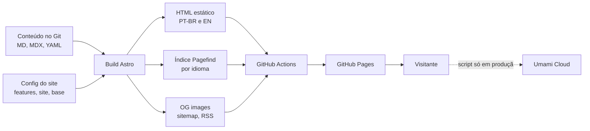
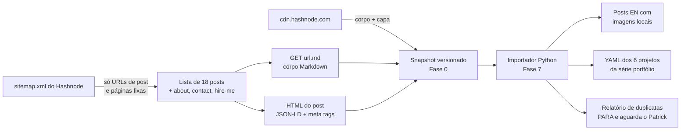

# TDD - Novo site cpatrickalves.com

| Campo | Valor |
| --- | --- |
| Tech Lead | Patrick Alves (`cpatrickalves`) |
| Time | Patrick Alves; agente Claude Code na execução |
| Épico / Tickets | [Milestones de `cpatrickalves/personal-site`](https://github.com/cpatrickalves/personal-site/milestones): um issue por entrega (#1 a #50), um milestone por fase |
| Plano de execução | [`docs/PLAN.md`](PLAN.md) |
| Design de referência | [getrubric.app](https://www.getrubric.app/) (só linguagem visual) |
| Glossário | [`GLOSSARY.md`](../GLOSSARY.md) |
| Status | Draft (revisado em 2026-10-29) |
| Criado | 2026-10-29 |
| Última atualização | 2026-10-29 |

> **Documento temporário.** Este TDD e o `docs/PLAN.md` existem só durante a implementação. Ao final, o que continuar valendo (arquitetura, decisões, como publicar e como escrever posts) vai para a documentação permanente gerada com a skill `/docs-generator`, e os dois arquivos são apagados.

**Divisão entre os dois documentos:** este TDD registra arquitetura, contratos e decisões. O `PLAN.md` é o roteiro de execução, com tarefas por fase, critérios de pronto, arquivos de origem das peças do karhdo.dev e os dados do autor. Quando os dois divergirem, vale o `PLAN.md` para o *como* e este TDD para o *porquê*. A divergência deve ser corrigida nos dois.

---

## Contexto

Hoje o cpatrickalves.com é um blog no Hashnode com domínio próprio, 18 posts em inglês, incluindo uma série de portfólio com 6 projetos de ciência de dados. O conteúdo só existe na plataforma. O repositório antigo `cpatrickalves/hashnode-blog` está parado desde 2023 e não serve como fonte.

O novo site é um site pessoal estático e bilíngue (PT-BR e EN). Ele apresenta quem é o Patrick e a Cognicode, e reúne blog, projetos e palestras. O site é construído com Astro sobre o tema AstroPaper, mais algumas peças copiadas do karhdo.dev, e publicado no GitHub Pages a partir de um repositório público. Todo o conteúdo fica versionado em Markdown, MDX e YAML no próprio repositório.

**Domínio:** publicação de conteúdo pessoal e profissional: blog técnico, portfólio e vitrine de consultoria. O vocabulário do domínio está no [`GLOSSARY.md`](../GLOSSARY.md).

**Stakeholders:**

- **Patrick:** autor, mantenedor e quem aprova design e conteúdo.
- **Leitores PT-BR e EN:** público do blog técnico (IA, agentes, ciência de dados).
- **Potenciais clientes da Cognicode:** chegam pela home e pela página de projetos.

## Definição do Problema

### Problemas que estamos resolvendo

- **Pouco controle de design e marca.** O Hashnode limita o layout e a identidade visual.
  - Impacto: o site não comunica a estética de IA e agentes que o Patrick quer, nem aceita componentes interativos (diagramas animados, MDX).
- **Não existe site bilíngue.** O Hashnode não oferece i18n de verdade, e os posts existem só em inglês.
  - Impacto: o público brasileiro fica de fora, e não há como ligar a versão PT-BR à EN do mesmo post.
- **É um blog, não uma vitrine.** Não há lugar para apresentação pessoal, para a Cognicode, para projetos em cards ou para palestras.
  - Impacto: quem chega pelo domínio não vê o trabalho profissional nem a consultoria.
- **Dependência da plataforma.** O conteúdo está preso no Hashnode, que não tem versionamento e pode mudar recursos ou preços a qualquer momento. Domínio próprio no Hashnode, por exemplo, hoje exige o plano Pro.
  - Impacto: risco de perder conteúdo e imagens (`cdn.hashnode.com`), e nenhum controle sobre o futuro do blog.

### Por que agora?

- O Patrick quer usar o site como vitrine da Cognicode e da sua atuação com IA e agentes.
- O conteúdo antigo ainda está no ar, com imagens acessíveis. Quanto mais tempo passa, maior o risco de perder parte dele. Por isso, o backup completo é feito já na Fase 0.

### Impacto de não resolver

- **Profissional:** a presença online continua sendo um blog genérico, sem portfólio nem consultoria.
- **Conteúdo:** os posts continuam dependentes de uma plataforma de terceiros, sem backup versionado.
- **Público:** os leitores em português continuam sem atendimento.

## Escopo

### ✅ No escopo (lançamento)

- Site estático em Astro 7 sobre o AstroPaper, com peças do karhdo.dev: barra superior, busca ⌘K, tema claro/escuro e Expressive Code.
- Design system próprio: tokens claro/escuro, fontes Outfit e Doto, componentes base, primitivas de animação e a página `/styleguide` (no dev e no preview, fora da produção).
- i18n com PT-BR na raiz e EN em `/en`: rotas, coleções, seletor de idioma, `hreflang`, sitemap, RSS e OG images por idioma.
- Páginas Home, Blog (lista e post), Projetos e Sobre. A página de Palestras fica pronta, mas oculta por flag.
- Posts com TOC, tempo de leitura, Mermaid, callouts, imagens com zoom e componentes MDX animados.
- Backup completo do Hashnode na Fase 0 (snapshot versionado) e Importação dos 18 posts a partir dele, com datas exatas e imagens locais. Os 6 posts da série portfólio também viram itens de Projetos.
- Versão PT-BR de todos os posts antes do lançamento: rascunho gerado pelo agente e revisado pelo Patrick.
- Analytics com Umami Cloud, só em produção.
- CI com build, checagem de links, Lighthouse e o script de traduções pendentes. Deploy no GitHub Pages pelo GitHub Actions.
- Virada do domínio do Hashnode para o GitHub Pages, envio do sitemap ao Google Search Console e um post curto de aviso no Hashnode.

### ❌ Fora do escopo

- Redirects dos links antigos do Hashnode (`/<slug>`): eles passam a dar 404. Decisão mantida na revisão de 2026-10-29, mesmo sabendo que os slugs não mudam e que o Astro gera redirects estáticos (meta refresh). Reabrir é barato: a lista de slugs fica no snapshot.
- Apagar ou editar os posts do Hashnode. Depois da Virada, o blog continua no ar em `*.hashnode.dev`, como está; o único acréscimo é o post de aviso.
- Contador público de views, comentários (giscus), newsletter e reações.
- Backend, banco de dados ou qualquer runtime de servidor.
- Rollback para o Hashnode depois da Virada. O corte é definitivo (ver [Plano de Rollback](#plano-de-rollback)).
- Nota de "traduzido do inglês" nos posts: as duas versões têm o mesmo peso.
- Peças do karhdo.dev fora da lista: Spotify, token burn, relógio, snowfall, career, views, reações, newsletter e adapter do Vercel.
- Bun, Biome e lefthook.

### 🔮 Para depois

- Ligar a seção de Palestras (só mudar a flag).
- Comentários, newsletter e redirects, se houver demanda.
- URL canônica nos posts do Hashnode apontando para o site novo, se o Search Console mostrar a cópia do Hashnode competindo com a nova.
- Trocar o domínio (por exemplo, para cpatrickalves.dev). A arquitetura já prevê isso: o domínio fica em um único ponto de configuração.

## Solução Técnica

### Visão geral da arquitetura

O site é 100% estático, gerado no build. Não há servidor, e todo o estado é conteúdo versionado no Git. A busca roda no navegador, sobre um índice gerado no build. O único script de terceiros é o do Umami.

**Componentes principais:**

| Componente | Responsabilidade |
| --- | --- |
| Coleções de conteúdo | Posts por idioma, páginas institucionais por idioma, projetos e palestras em YAML bilíngue. O schema é validado no build. |
| Camada de i18n | Strings de UI por idioma, helpers de URL por idioma (que também aplicam o `base`), resolução da versão equivalente no outro idioma e formatação de datas. |
| Layout e navegação | Barra superior com menu mobile, seletor de idioma, alternância de tema, rodapé e 404. |
| Busca ⌘K | Paleta de comandos (ilha React) sobre o índice Pagefind. O Pagefind cria um índice por `<html lang>` e carrega o do idioma da página. |
| Tema | Claro, escuro e "sistema", aplicado antes da primeira pintura para não piscar. |
| Design system | Tokens CSS, fontes (Fonts API do Astro, chave `fonts`), componentes base e primitivas de animação que respeitam `prefers-reduced-motion`. |
| Renderização de posts | Expressive Code, Mermaid (astro-mermaid, renderizado no navegador) com tema automático, callouts, zoom de imagens e componentes MDX animados. |
| Gerador de OG images | Uma imagem por post e por idioma, gerada no build. |
| Pipeline de CI/CD | Build e checagens em todo PR e na `main`; o deploy no Pages só roda se as checagens passarem. |
| Backup e importador do Hashnode | Scripts Python avulsos, fora do build do site. Na Fase 0, o backup baixa um snapshot completo do Hashnode. Na Fase 7, o importador converte o snapshot em posts e projetos. |

### Mapa de rotas

Os nomes das seções ficam em inglês nos dois idiomas.

| Página | PT-BR | EN | No lançamento |
| --- | --- | --- | --- |
| Home | `/` | `/en/` | Visível |
| Blog | `/blog/`, `/blog/<slug>/` | `/en/blog/`, `/en/blog/<slug>/` | Visível |
| Projetos | `/projects/` | `/en/projects/` | Visível |
| Palestras | `/talks/` | `/en/talks/` | Oculta (flag) |
| Sobre | `/about/` | `/en/about/` | Visível |
| RSS | `/rss.xml` | `/en/rss.xml` | Visível |
| Styleguide | `/styleguide/` | — | Só no dev e no preview |

Até o lançamento, todas as rotas ficam sob o prefixo `/personal-site`. Por isso, todo link interno passa pelos helpers de URL, e nenhum caminho é escrito à mão.

O feed `/rss.xml` era o do Hashnode, em inglês. Depois da Virada, ele passa a servir os posts PT-BR, e o feed EN fica em `/en/rss.xml`. O post de aviso no Hashnode informa essa mudança.

### Modelo de conteúdo

**Post** (um arquivo por idioma; as duas versões de um post se ligam pelo mesmo nome de arquivo, portanto pelo mesmo slug):

| Campo | Tipo | Regra |
| --- | --- | --- |
| `title` | string | obrigatório |
| `description` | string | obrigatório; vira meta description e texto do card |
| `pubDatetime` | datetime ISO, UTC | obrigatório. Nos posts importados, vem do `datePublished` do Hashnode, nunca da data do commit. A outra versão herda o mesmo valor. |
| `modDatetime` | datetime ISO, UTC | opcional; vem do `dateModified`. A outra versão herda o mesmo valor. |
| `tags` | lista de strings | usadas no filtro e na busca. São as mesmas nas duas versões (termos técnicos em inglês). |
| `ogImage` | imagem | opcional; sem ela, a OG image é gerada |
| `draft` | boolean | fora do build quando verdadeiro |
| `featured` | boolean | destaque na home |
| `translationReviewed` | boolean | opcional. `false` nos rascunhos de tradução gerados pelo agente; o Patrick muda para `true` ao aprovar. Ausente nas versões originais. |
| `fake` | boolean | marca os dados fake, que saem do build no início da Fase 7 |

O idioma de um post vem da pasta onde ele está, não de um campo no frontmatter. As datas são guardadas em UTC e exibidas no fuso America/Sao_Paulo nos dois idiomas.

**Projeto** (um YAML por item, com campos bilíngues):

| Campo | Tipo | Regra |
| --- | --- | --- |
| `title` | `{pt-br, en}` | obrigatório |
| `description` | `{pt-br, en}` | obrigatório |
| `cover` | imagem | obrigatório no card |
| `date` | data | ordena a grade |
| `stack` | lista de strings | exibida como badges. Nos projetos importados, vem das tags do post. |
| `links` | repo, demo e post (todos opcionais) | os projetos da série portfólio apontam para o post completo, na versão do idioma atual |
| `featured` | boolean | a home mostra até 3 projetos: os `featured: true` mais recentes por `date` |
| `fake` | boolean | igual ao dos posts |

Um texto longo de projeto vira um Markdown por idioma.

**Palestra** (YAML bilíngue):

| Campo | Tipo | Regra |
| --- | --- | --- |
| `title` | `{pt-br, en}` | obrigatório |
| `description` | `{pt-br, en}` | opcional; resumo curto no card |
| `event` | string | obrigatório |
| `date` | data | obrigatório; ordena a lista |
| `location` | string | obrigatório (cidade ou "online") |
| `language` | `pt-br` ou `en` | obrigatório; idioma em que a palestra foi apresentada |
| `links` | slides e vídeo (opcionais) | |
| `fake` | boolean | igual ao dos posts |

**Config do site:** URL do site, `base` (só até o lançamento), `features.talks` (boolean), `timezone: "America/Sao_Paulo"` (o exemplo do AstroPaper vem com Asia/Bangkok), locales `["pt-br", "en"]` com `pt-br` como padrão e sem prefixo.

### Regras de comportamento

- **Seletor de idioma:** leva à versão equivalente da página atual. Numa página de tag, leva à mesma tag no outro idioma. Se não houver versão no outro idioma, leva à lista da mesma seção no outro idioma.
- **Listas:** cada idioma mostra só os seus próprios posts. Toda lista tem um estado vazio desenhado (idioma sem posts, tag sem posts, Palestras sem itens).
- **Flag `features.talks = false`:** a seção sai do menu e da home, a rota não é gerada e não entra no sitemap.
- **Dados fake:** aparecem no preview até a Fase 7. No início dela, saem do build e são apagados. Enquanto as versões PT-BR não chegam, as listas PT-BR mostram o estado vazio.
- **Preview × produção:** derivado do config. Com `base` é preview; sem `base` é produção. No preview há `noindex`, o `/styleguide` é publicado e não há Umami. Na produção não há `noindex`, o `/styleguide` fica fora do build e o script do Umami entra, com `data-domains="cpatrickalves.com"` como segunda trava. Remover o `base` na Fase 8 vira tudo de uma vez.
- **SEO:** `<html lang>` correto, `hreflang` recíproco entre PT-BR e EN, sitemap com os dois idiomas e OG image por idioma.

### Ambientes

| Ambiente | URL | Indexação | Umami | `/styleguide` | Quando existe |
| --- | --- | --- | --- | --- | --- |
| Local | dev server | n/a | não | sim | sempre |
| Preview | `cpatrickalves.github.io/personal-site` | `noindex` | não | sim | Fases 0 a 7 |
| Produção | `cpatrickalves.com` | indexado | sim | não | a partir da Fase 8 |

O domínio aparece em um só lugar: o campo `site` da config do Astro e as Settings → Pages do repo. Não existe arquivo `CNAME`, porque o deploy por workflow do Actions o ignora.

Depois do lançamento não há mais preview publicado: o GitHub Pages tem um só site por repo. Mudanças são revisadas localmente com `pnpm build && pnpm preview`, e o merge na `main` vai direto para a produção, desde que as checagens passem.

O user site antigo `cpatrickalves.github.io` (repo `cpatrickalves.github.io`) já redireciona para cpatrickalves.com e não precisa de mudança.

### Backup (Fase 0) e Importação (Fase 7)

A coleta e a conversão são separadas. O backup roda na Fase 0 e grava um snapshot versionado, fora do build. O importador da Fase 7 lê só do snapshot, nunca da rede.

Fatos verificados em 2026-10-29: o sitemap lista 18 posts, e o `GET <post>.md` responde 200 com `text/markdown` nos 18 (sem frontmatter, com o título como H1). O HTML de cada post traz JSON-LD `BlogPosting` com `datePublished`, `dateModified` e `keywords`.

| Origem no Hashnode | Destino |
| --- | --- |
| `datePublished` (JSON-LD) | `pubDatetime` |
| `dateModified` (JSON-LD) | `modDatetime` |
| `keywords` (JSON-LD) | `tags` |
| `<meta name="description">` | `description` |
| `og:image` | capa |
| corpo do `.md` | conteúdo, sem o H1 do título, com imagens reescritas para caminhos locais e sem atributos `align` |

O snapshot também guarda as páginas `/page/about`, `/page/contact` e `/page/hire-me`, cujo texto serve de ponto de partida para a página Sobre e para o bloco da Cognicode, e as métricas do Hashnode (export ou prints).

O importador é idempotente: lê sempre a mesma entrada, então rodar duas vezes dá o mesmo resultado.

**Versões PT-BR:** logo após a Importação, o agente gera um rascunho PT-BR de cada post com `translationReviewed: false`. O Patrick revisa, ajusta o tom e muda o campo para `true`.

## Considerações de Segurança

O site é estático: não tem autenticação, formulários, backend nem dados de usuário. A superfície de ataque se resume à cadeia de build e aos scripts que rodam no navegador.

- **Repositório público:** o GitHub Pages no plano Free só publica repos públicos, então o repo `personal-site` fica público. Rascunhos (`draft: true`), rascunhos de tradução e o histórico ficam visíveis; nada que não possa ser público entra num commit.
- **Segredos:** não há segredos no runtime. O ID do site no Umami é público por natureza. O deploy usa o token efêmero do próprio GitHub Actions, sem chave pessoal.
- **Permissões do workflow:** o mínimo necessário. Leitura do conteúdo, e escrita no Pages só no job de deploy da `main`. PRs de forks não publicam nada.
- **Domínio:** o domínio cpatrickalves.com é verificado nas configurações de Pages da conta do GitHub antes da Virada, para que outro repo não possa assumi-lo.
- **Dependências:** lockfile do pnpm versionado e instalação congelada no CI. As peças do karhdo.dev e o snapshot do AstroPaper são copiados, isolados e revisados na entrada, e não viram dependência remota.
- **Scripts de terceiros:** só o do Umami, carregado apenas em produção e restrito a `cpatrickalves.com` por `data-domains`.
- **Transporte:** HTTPS obrigatório no Pages (Enforce HTTPS) a partir da Fase 8.
- **Privacidade e LGPD:** o Umami não usa cookies e não coleta dados pessoais identificáveis (confirmado na documentação em 2026-10-29), por isso o site não precisa de banner de consentimento. O e-mail de contato publicado na página Sobre fica exposto a spam, e isso é aceito.
- **Conteúdo MDX:** só o autor escreve componentes. Não há conteúdo de terceiros renderizado como código.

## Estratégia de Testes

| Tipo | Escopo | Critério | Bloqueia o PR? | Quando |
| --- | --- | --- | --- | --- |
| Build e tipos | Site inteiro, incluindo a validação de schema das coleções | build e checagem de tipos sem erro | sim | todo PR e push na `main` |
| Links internos | Links internos do HTML gerado | zero links quebrados | sim | todo PR |
| Links externos | Links externos do HTML gerado | relatório | não; um job semanal abre issue | todo PR e semanal |
| Lighthouse (a11y e SEO) | Páginas representativas (home, lista, post, projetos) nos dois idiomas | > 95 | sim | todo PR a partir da Fase 6 |
| Lighthouse (performance) | As mesmas páginas, mediana de 3 execuções | > 95 | não; aviso no PR e portão manual no pré-lançamento | todo PR a partir da Fase 6 |
| Traduções pendentes | Posts sem versão no outro idioma ou com `translationReviewed: false` | relatório no CI; zero no lançamento | não | todo PR |
| Fidelidade da importação | Datas de cada post importado comparadas com o JSON-LD do snapshot | nenhuma diferença | — | Fase 7 |
| i18n | Toda página existe nos dois idiomas, com `hreflang` recíproco e seletor apontando para a versão equivalente | sem página órfã | — | Fase 2 em diante |
| Preview × produção | HTML de um build sem `base` comparado com o do preview | Umami e sem `noindex` só na produção; `/styleguide` só no preview | — | Fase 6 |
| Visual e manual | `/styleguide` e cada página nos dois idiomas e nos dois temas, no desktop e no celular | aprovação do Patrick | — | Fases 1, 3 e 5 |

**Cenários críticos:**

- Tema escolhido persiste entre páginas, sem piscar na carga.
- Busca ⌘K só retorna resultados do idioma atual e funciona pelo teclado.
- Com `features.talks = false`, não sobra nenhum rastro de Palestras: menu, home, rota e sitemap.
- Com os dados fake fora do build e só os posts EN importados, as listas PT-BR mostram o estado vazio, sem página quebrada.
- `prefers-reduced-motion` desliga reveal, hover animado e View Transitions.
- Com o `base` removido (simulação da Fase 8), todos os links internos continuam funcionando, o `noindex` some, o Umami entra e o `/styleguide` sai.
- O post de dados fake com diagramas Mermaid mantém o Lighthouse de performance acima de 95. Se não mantiver, a alternativa é renderizar no build com rehype-mermaid (exige Playwright no CI).

**Dados de teste:** os dados fake da Fase 4 (3 posts por idioma, 6 projetos, 2 palestras e textos placeholder). Eles cobrem paginação, filtro por tag, busca, Mermaid, código longo e MDX animado.

## Monitoramento e Observabilidade

Não há servidor para monitorar. A observabilidade cobre três frentes: a saúde do pipeline, o tráfego e a indexação.

| Sinal | Fonte | Gatilho de ação |
| --- | --- | --- |
| Falha de build ou deploy | GitHub Actions (notificação por e-mail) | qualquer falha na `main` |
| Links internos quebrados | Link-checker no CI | bloqueia o PR |
| Links externos quebrados | Job semanal do link-checker | abre issue |
| Regressão de qualidade | Lighthouse no CI | acessibilidade ou SEO abaixo de 95 bloqueia o PR; performance abaixo de 95 gera aviso |
| Tráfego: posts mais lidos, origem, países, dispositivos | Umami Cloud (Hobby: 100 mil eventos por mês, 1 site) | revisão manual; queda brusca depois de um deploy merece investigação |
| Indexação, 404 e conteúdo duplicado | Google Search Console | erros de cobertura nas semanas após o lançamento; posts do `*.hashnode.dev` competindo com os novos |

O GitHub Pages mantém no ar o último deploy bem-sucedido. Uma falha de build não derruba o site, só impede a atualização.

## Plano de Rollback

**Decisão: corte definitivo.** Depois da Virada, não há volta para o Hashnode. Qualquer problema se resolve com um novo deploy. Como não há caminho de volta, a segurança está no portão de pré-lançamento. O blog do Hashnode continua no ar em `*.hashnode.dev`, mas não é caminho de volta: ele só fica como está.

### Portão antes da Virada (Fase 8)

Todos os itens precisam estar ok antes de tirar o domínio do Hashnode:

- [ ] Os critérios de pronto das Fases 0 a 7 passam no preview.
- [ ] Os 18 posts estão importados, com imagens locais, e o teste de datas não acha diferença.
- [ ] Zero traduções pendentes (toda versão PT-BR com `translationReviewed: true`).
- [ ] Simulação sem `base` feita; o link-checker passa.
- [ ] Backup completo do Hashnode (snapshot da Fase 0, com Markdown, HTML, imagens e métricas) no repo.
- [ ] Script do Umami presente no build de produção e ausente no preview; meta de Lighthouse (incluindo performance) batida.
- [ ] Domínio cpatrickalves.com verificado nas configurações de Pages da conta do GitHub.
- [ ] TTL dos registros DNS reduzido um dia antes.
- [ ] Post de aviso no Hashnode pronto, com o link do site novo e do feed `/en/rss.xml`.

### Depois do lançamento

| Gatilho | Ação |
| --- | --- |
| Deploy publicou algo quebrado | Reverter o commit na `main`; o workflow republica a versão anterior |
| Build quebrado na `main` | Nada cai (o Pages mantém o último deploy); corrigir no PR seguinte |
| DNS ou HTTPS com problema | Conferir os registros A e o CNAME do `www` e aguardar a emissão do certificado; sem volta ao Hashnode |
| Umami sem eventos depois da Virada | Conferir o ID do site e o `data-domains` no HTML; corrigir e publicar |
| Página ou post com erro de conteúdo | Corrigir no Markdown e publicar |

## Plano de Implementação

O detalhamento de tarefas e os critérios de pronto estão no [`PLAN.md`](PLAN.md). As fases rodam em sequência, e cada uma só fecha quando o critério de pronto passa no preview publicado.

| Fase | Entrega | Depende de | Portão de aprovação |
| --- | --- | --- | --- |
| 0. Setup | Repo público, snapshot do AstroPaper (commit da `main`, Astro 7), Node 24, CI de build, deploy do preview com `noindex`, créditos MIT, backup completo do Hashnode | — | — |
| 1. Design system | Tokens, 3 propostas de paleta, fontes, componentes base, animações, `/styleguide` publicado no preview | 0 | **Paleta e `/styleguide`** |
| 2. i18n | Locales, coleções por idioma, helpers de URL, `hreflang`, sitemap, RSS, script de pendências | 1 | — |
| 3. Layout e navegação | Header, menu mobile, busca ⌘K, tema, seletor de idioma, rodapé, 404 | 2 | — |
| 4. Dados fake | Posts, projetos, palestras e textos placeholder nos dois idiomas | 3 | — |
| 5. Páginas | Home, Blog, Projetos, Sobre, Palestras (oculta), estados vazios, OG images | 4 | **Cada página, nos 2 idiomas e nos 2 temas** |
| 6. Analytics, SEO e qualidade | Umami só em produção, Lighthouse, link-checker | 5 | — |
| 7. Importação | 18 posts a partir do snapshot, projetos da série portfólio, rascunhos PT-BR, remoção dos dados fake | 6 | **Relatório de duplicatas**; revisão de cada versão PT-BR |
| 8. Lançamento | Domínio, HTTPS, DNS, remoção do `noindex` e do `base`, Search Console, post de aviso no Hashnode | 7 + portão de pré-lançamento | **Virada** |

**Caminho crítico:** a revisão das 18 versões PT-BR (Fase 7) depende só do Patrick e continua sendo o item mais longo antes do lançamento, mas os rascunhos do agente a tornam bem mais curta que traduzir do zero.

## Riscos

| Risco | Impacto | Probabilidade | Mitigação |
| --- | --- | --- | --- |
| Imagens ou posts do Hashnode somem antes da Importação | Alto | Baixa | Snapshot completo na Fase 0; a Importação lê só dele |
| Endpoint `GET <url>.md` muda antes do backup | Alto | Baixa | Verificado em 2026-10-29 nos 18 posts; o backup roda na Fase 0. Plano B: converter o HTML do post para Markdown. |
| Sem rollback depois da Virada (corte definitivo) | Alto | Baixa | Portão de pré-lançamento e backup completo do Hashnode antes de tirar o domínio |
| Posts do `*.hashnode.dev` competem com os novos no Google (o blog fica como está) | Médio | Média | Acompanhar no Search Console; se acontecer, pôr URL canônica nos posts do Hashnode apontando para o site novo |
| Links antigos do Hashnode (`/<slug>`) dão 404 | Médio | Alta | Aceito: redirects fora do escopo. Acompanhar os 404 no Search Console. |
| Revisão das versões PT-BR atrasa o lançamento | Médio | Média | Rascunhos do agente logo após a Importação; a revisão pode correr em paralelo com ajustes finais |
| Rascunho de tradução mal revisado vai ao ar | Médio | Baixa | O script de pendências só conta uma versão como pronta com `translationReviewed: true` |
| Repo público expõe rascunhos ou anotações | Baixo | Média | Nada que não possa ser público entra num commit |
| Snapshot do AstroPaper vem de um commit sem tag (Astro 7 ainda não tem release do tema) | Médio | Baixa | Commit fixo, registrado em `THIRD_PARTY_NOTICES.md`; o CI da Fase 0 mostra se algo quebrou |
| Links internos quebram ao remover o `base` | Médio | Média | Helpers de URL em todo link e simulação sem `base` no portão de pré-lançamento |
| Ilhas React e Mermaid pesam no Lighthouse | Médio | Média | Hidratar só sob demanda (busca ao abrir a paleta, componentes ao entrar na tela); o mermaid só carrega em páginas com diagrama; rehype-mermaid no build como alternativa |
| Umami só comprovado depois da Virada | Baixo | Baixa | Inspeção do HTML na Fase 6; um erro se corrige com um deploy |
| Copiar demais o Rubric | Médio | Baixa | Usar fontes, estilo e animações; nunca o logo, o cursor hexagonal ou os textos deles |
| Fork divergente das peças do karhdo.dev | Baixo | Média | Copiar só os componentes listados, isolados em pastas próprias |

## Questões em Aberto

| # | Questão | Contexto | Responsável | Status |
| --- | --- | --- | --- | --- |
| 1 | Como trazer o AstroPaper para um repo que já existe? | Snapshot: os arquivos de um commit fixo da `main` entram num commit só, e a origem fica registrada em `THIRD_PARTY_NOTICES.md` | Patrick | ✅ Resolvida (2026-10-29) |
| 2 | Para qual post os projetos da série portfólio apontam? | Três dos seis slugs da série (`accelerating-claim-approval-…`, `classifying-the-floor-surface-to-help-robots-…`, `predict-the-occurrence-of-diabetes`) estão nos pares de possíveis duplicatas. A decisão sobre duplicatas define o link do card. | Patrick (Fase 7) | 🔴 Aberta |
| 3 | O endpoint `.md` do Hashnode funciona para todos os posts? | Sim: 200 com `text/markdown` nos 18 posts, testado em 2026-10-29 | Agente | ✅ Resolvida (2026-10-29) |
| 4 | Qual versão do Astro usar? | Astro 7 (latest 7.4.4, exige Node >= 22.23.4). O AstroPaper suporta o Astro 7 na `main`, ainda sem release. Node 24 LTS. | Patrick | ✅ Resolvida (2026-10-29) |
| 5 | Como revisar mudanças depois do lançamento? | Revisão local com `pnpm build && pnpm preview`; o deploy só roda se as checagens passarem na `main` | Patrick | ✅ Resolvida (2026-10-29) |
| 6 | O que fazer com seguidores e assinantes do Hashnode? | O blog do Hashnode fica como está, e um post curto de aviso aponta para o site novo e para o feed `/en/rss.xml` | Patrick | ✅ Resolvida (2026-10-29) |
| 7 | Formato final do YAML de palestras | Proposta do TDD mais `description` e `language` (ver Modelo de conteúdo) | Patrick | ✅ Resolvida (2026-10-29) |
| 8 | Paleta de cores | Escolher uma de 3 propostas | Patrick (Fase 1) | 🔴 Aberta |
| 9 | Conta e ID do site no Umami Cloud | Necessário para a Fase 6 (plano Hobby: 1 site) | Patrick | 🔴 Aberta |
| 10 | Dados do autor (nome, bio, foto, redes, texto da Cognicode, favicon) | Tabela no `PLAN.md`; placeholders até a Fase 5. O backup traz as páginas about e hire-me do Hashnode como ponto de partida. | Patrick (antes da Fase 5) | 🔴 Aberta |
| 11 | Nome do repositório | `personal-site` | Patrick | ✅ Resolvida |
| 12 | Rollback depois da Virada | Corte definitivo, sem volta ao Hashnode | Patrick | ✅ Resolvida (2026-10-29) |
| 13 | Repo privado no GitHub Pages | O plano Free não publica Pages de repo privado; o repo vira público antes da Fase 0 | Patrick | ✅ Resolvida (2026-10-29) |
